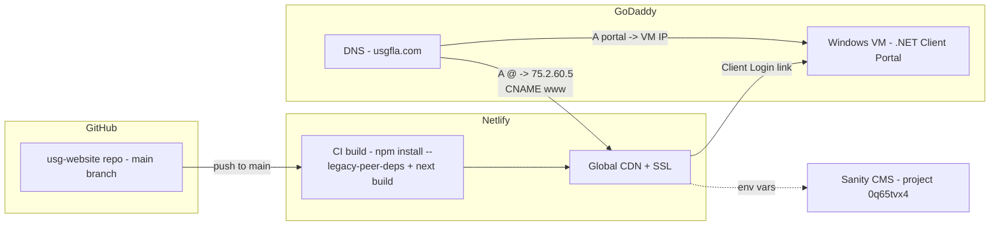

# USG Website — Technical Runbook (for Elliot)

Companion to `HANDOFF-GUIDE.md`. That doc is the business-level 1-2-3; this is everything
a developer needs to run, change, transfer, and integrate the site without guessing.

---

## 1. System Architecture



Two independent systems share one domain: the marketing site (Netlify, auto-deployed
from GitHub) and the client portal (.NET on the VM). DNS is the only glue.

## 2. Stack & Versions

| Layer | Tech | Version notes |
|---|---|---|
| Framework | Next.js **14.2.x**, App Router, TypeScript | React 18 |
| Styling | Tailwind CSS 3.4 | brand theme in `tailwind.config.ts` |
| 3D | three **0.171.0**, @react-three/fiber **8.18**, @react-three/drei **9.122** | ⚠️ pinned for React 18 compat — do not bump majors casually |
| Motion | framer-motion, GSAP, Lenis | |
| CMS | Sanity v3 (project `0q65tvx4`) | client in `lib/sanity.ts` |
| Hosting | Netlify + `@netlify/plugin-nextjs` | config in `netlify.toml` |
| Node | Developed on Node 20/22 | any ≥18 works |

## 3. Local Development

```bash
git clone https://github.com/universalgraphicstampafl-max/usg-website.git
cd usg-website
npm install --legacy-peer-deps        # REQUIRED: R3F/drei peer-dependency conflicts
cp .env.example .env.local             # create if absent — variables below
npm run dev                            # http://localhost:3000
```

**`.env.local` contents:**

```bash
NEXT_PUBLIC_SANITY_PROJECT_ID=0q65tvx4
NEXT_PUBLIC_SANITY_DATASET=production
SANITY_API_TOKEN=<get from Sanity manage → API → Tokens>
```

> 🔐 **On transfer: rotate `SANITY_API_TOKEN`.** Generate a new token under USG's Sanity
> account, update it in Netlify (Site settings → Environment variables), and revoke the old
> one. Netlify's site transfer carries env vars across, but the token was issued under the
> previous owner — rotating it completes the ownership hand-over.

**Build verification without deploying:** `npx tsc --noEmit` (type check) and
`npm run build` (full build — requires network access for Google Fonts).

## 4. Deploy Pipeline

Push to `main` → Netlify runs `npm install --legacy-peer-deps && npm run build` →
publishes `.next` via the Next.js runtime plugin → live in ~2 minutes. No manual step
exists anywhere; rollback = Netlify UI → Deploys → pick a previous deploy → Publish.
Existing redirects (301s for retired routes) live in `next.config.mjs` → `redirects()`.

## 5. Repo Map — where things live

| Path | What it is |
|---|---|
| `app/page.tsx` | Homepage (hero, clients, services, stats, process, industries, CTA) |
| `app/about/`, `app/services/*`, `app/contact/` … | All routes |
| `components/StoreExplorer.tsx` | **The 3D showroom.** Hotspot data (titles, copy, image sets, pin coordinates) is the two arrays at the top: `EXTERIOR_HOTSPOTS` / `INTERIOR_HOTSPOTS` |
| `components/GalleryClient.tsx` | **The gallery grid.** `ITEMS` array = every tile (src, title, category) |
| `components/Nav.tsx` | Header incl. Client Login (2 places: desktop + mobile drawer) |
| `lib/booking.ts` | The one `BOOKING_URL` constant behind every "Book a Call" button |
| `lib/sanity.ts` | Sanity client (env-var driven) |
| `public/images/gallery/` | Gallery tile images |
| `public/images/signtypes/panels/` | 3D pin panel images (`{id}-1/2/3.webp` naming) |
| `public/models/` + `public/models/licenses/` | CC-BY GLB assets + license texts (**must ship**) |
| `public/textures/` | Procedural textures for the 3D scene |
| `docs/` | This documentation set |

## 6. The Client Login Change (exact diff)

`components/Nav.tsx` — two occurrences of `href="/client-login"`:

```diff
- <Link href="/client-login" className="btn-outline">
+ <a href="https://portal.usgfla.com" className="btn-outline">
    Client Login
- </Link>
+ </a>
```

(Repeat for the mobile drawer instance ~60 lines below. Using `<a>` because it is an
external origin; or keep `Link` with the absolute URL — both work.)

Optional cleanup: retire the placeholder page by adding to `next.config.mjs` redirects:

```js
{ source: '/client-login', destination: 'https://portal.usgfla.com', permanent: false },
```

## 7. Portal Integration Artifacts

### Option A — subdomain (recommended)

1. DNS: `A portal → <VM public IP>` (GoDaddy).
2. IIS binding on the VM:

```powershell
New-WebBinding -Name "ClientPortal" -Protocol http -Port 80 -HostHeader "portal.usgfla.com"
# SSL via win-acme (free Let's Encrypt):
#   download https://www.win-acme.com → run wacs.exe → N (new cert) → pick the IIS site
#   → win-acme creates the 443 binding + auto-renewal task
```

3. Make the Nav change from §6. Done.

### Option B — path proxy (`/portal`)

`netlify.toml` addition:

```toml
[[redirects]]
  from = "/portal/*"
  to = "https://portal.usgfla.com/:splat"   # or https://<VM-IP> with valid cert
  status = 200
  force = true
```

ASP.NET Core must be path-based:

```csharp
app.UsePathBase("/portal");   // before UseRouting; ensure all links are relative
```

Caveats: portal cookies should be `Path=/portal`; if the VM is down, `/portal` errors on
the main domain; WebSockets/SignalR through Netlify proxying can be problematic. Option A
avoids all three.

### Option C — API integration (phase 2)

.NET side (Program.cs):

```csharp
builder.Services.AddCors(o => o.AddPolicy("site", p => p
    .WithOrigins("https://usgfla.com", "https://www.usgfla.com")
    .AllowAnyHeader().AllowAnyMethod().AllowCredentials()));
app.UseCors("site");
```

Site side — call the portal server-side so tokens never reach the browser
(`app/api/portal/[...path]/route.ts` proxy pattern), or client-side fetch for public data.
Shared auth: issue the auth cookie with `Domain=.usgfla.com` (requires Option A's
subdomain layout) or use JWT bearer tokens.

## 8. Transfer-Day Checklist (run top to bottom)

- [ ] USG GitHub org created → repo transferred → Elliot admin → `git clone` works
- [ ] USG Netlify account → site transferred → GitHub reconnected → push a trivial commit → deploy goes green
- [ ] Netlify env vars present post-transfer (`NEXT_PUBLIC_SANITY_PROJECT_ID`, `NEXT_PUBLIC_SANITY_DATASET`, `SANITY_API_TOKEN`)
- [ ] `SANITY_API_TOKEN` rotated to a USG-issued token; old token revoked
- [ ] Sanity: USG email is Administrator on project `0q65tvx4`
- [ ] DNS cutover done → verify: `nslookup usgfla.com` → `75.2.60.5`; `curl -I https://usgfla.com` → 200 + valid cert
- [ ] Portal DNS → verify: `nslookup portal.usgfla.com` → VM IP; portal loads over HTTPS
- [ ] Client Login points at the portal (both desktop and mobile nav)
- [ ] CC-BY credit line visible in the 3D showroom; `public/models/licenses/` intact
- [ ] Brey's personal access removed from GitHub/Netlify/Sanity (or set to agreed support level)

## 9. Known Gotchas (learned the hard way — read before debugging)

1. `npm install` **fails without** `--legacy-peer-deps` (three.js ecosystem peer conflicts).
2. Never remount the R3F `<Canvas>` with a changing `key` — it leaks the WebGL context
   (black canvas). Camera/scene switching is done inside one canvas via `CameraRig`.
3. Three/fiber/drei versions are pinned for React 18. Upgrading to React 19 requires
   moving all three together (fiber v9+).
4. The 3D models are draco-compressed; the decoder loads from Google's CDN at runtime —
   an aggressive corporate proxy that blocks `www.gstatic.com` will break model loading.
5. `next build` downloads Google Fonts — build environments need outbound network.
6. Image-swap convention: replacing a file **keeping the same filename** requires zero
   code changes anywhere. Prefer ~1,200–1,500px `.webp`.
7. After heavy edits to `app/page.tsx` in dev, if hot reload renders stale output:
   `rm -rf .next` and restart dev.
8. Gallery tiles carry an `ar` (aspect ratio) field in `GalleryClient.tsx` — when swapping
   a tile image to a different shape, update `ar` to match (width÷height) for correct
   masonry layout.

## 10. Contacts

- Build/dev questions: Dubrey "Brey" Black (author)
- Design source files: Olivia Burkhardt (logo), USG marketing (product art)
- Everything in this doc is also in the repo history — `git log --oneline` reads as a
  build journal of every decision.
